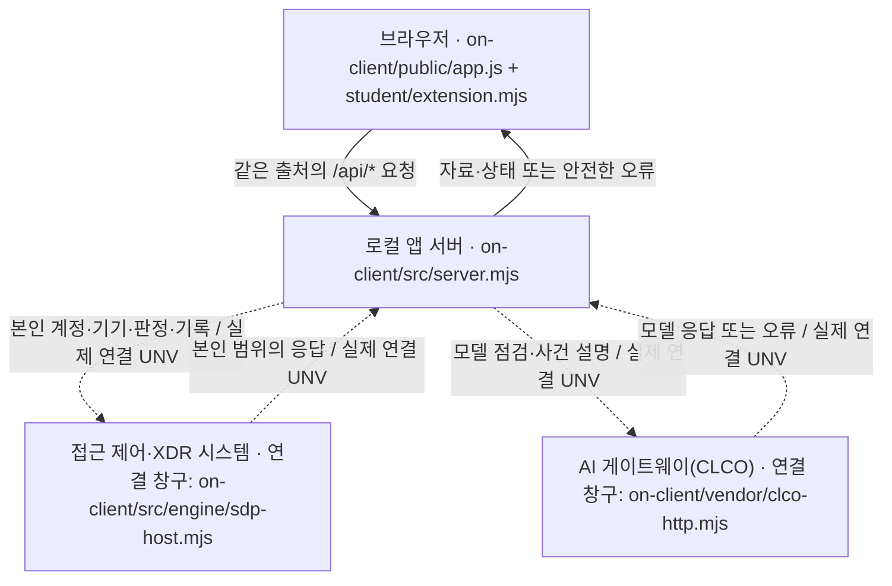

# 케셰브 · 학생용 실행 설명서와 시스템 구성도

## 1. 목적, 문서 범위, 확인 기준

직원이 본인의 계정·기기·현재 연결 세션, 업무 앱 접근 판정, 최근 접속 기록·저장된 XDR 경보를 보는 수업용 보안 Agent입니다. 사용자 화면의 성공 문구를 인증·과제 통과·실제 보안 조치의 근거로 사용하지 않습니다.

이 문서는 21단계 학생 작성 문서입니다. 코드 기준은 `6b54780c272d3b460c711e8aa9b791139dc8650f`(20단계)이며, 이번 단계는 이 문서와 `on-client/student/README.md`만 추가합니다. 앞 단계 함수와 제공 문서·서버·인증 설정은 유지합니다. 제출 커밋은 문서를 추가해 커밋한 뒤 실제 출력된 값이며, 이 기준 커밋을 21단계 제출 번호로 대신 쓰지 않습니다.

| 증거 구분 | 이 문서에서의 의미 |
|---|---|
| 코드 대조 | 현재 파일·함수·설정 견본에서 확인한 계약입니다. 실제 외부 연결 성공을 뜻하지 않습니다. |
| 모의 검사 | 합성 입력, 별도 시험 폴더 또는 격리된 제공 흐름으로 점검한 결과입니다. 실제 학생 계정 자료가 아닙니다. |
| 로컬 HTTP 검사 | AI 개발 검사 환경에서 제공 서버를 loopback으로 실행한 응답입니다. 사용자 PC 브라우저나 운영 서버의 결과가 아닙니다. |
| 사용자 PC 확인 | 이 대화에서 사용자가 전달한 실행 출력·화면으로 확인한 범위입니다. 예제 자료는 실제 계정 자료와 구분합니다. |
| 미확인·기다림(UNV) | 실제 연결·권한·조회·집행의 근거가 없거나 운영 측 준비가 필요한 항목입니다. |

기본 앱 이름은 케셰브입니다. 실행에 쓰는 `alekov` 파일명과 `alekov-client-starter` 패키지 이름은 바꾸지 않았습니다.

## 2. 필요 프로그램과 실제 확인 버전

| 항목 | 확인한 값과 범위 |
|---|---|
| 사용자 PC | Windows PowerShell 사용. Windows·PowerShell의 정확한 버전은 미확인입니다. |
| Node.js | 사용자 출력 `v24.19.0`. `on-client/package.json`의 engines 기준도 `24.19.0`입니다. |
| Git | 사용자 출력 `git version 2.56.0.windows.4`. clone·커밋·push 기록이 있습니다. |
| 브라우저 | 사용자 PC에서 loopback 화면 확인. 제품·정확한 버전은 미확인입니다. |
| 앱 패키지 | `alekov-client-starter` 버전 `0.2.14`. 제공 manifest는 파일 해시 목록이며 앱 버전은 `package.json`을 봅니다. |
| 개발 검사 환경 | Node.js `v24.22.1`에서 문법·모의·루프백 검사를 실행했습니다. PowerShell이 없어 이번 환경에서 Windows 실행 명령을 재실행하지 않았습니다. |

제공 실행 도구는 Node.js 22~24를 허용합니다. 사용자 PC 재현 기준은 실제 사용한 24.19.0이며, 다른 버전·macOS·다른 PC의 전체 연결 흐름은 확인하지 않았습니다. 이 프로젝트는 워크벤치 설치 없이 Git과 PowerShell로 진행했습니다. 워크벤치를 켜 두는 것은 로컬 앱 실행 조건이 아닙니다.

Node.js와 Git이 없는 새 PC에서는 각각 [Node.js 공식 사이트](https://nodejs.org/)와 [Git for Windows 공식 안내](https://git-scm.com/install/windows)를 이용해 설치하고 PowerShell을 새로 엽니다. 이 문서는 임의 설치·업데이트 명령을 추가하지 않습니다. 이미 사용자 PC에서 실행한 버전 확인 명령은 다음과 같습니다.

```powershell
node --version
git --version
```

`on-client/package.json`에는 외부 npm 의존성이 없고, 기준 커밋의 `on-client`에는 `package-lock.json`이 없습니다. 현재 앱을 켜기 위해 `npm install`이나 `npm ci`를 필수로 추가하지 않습니다. 저장소 루트의 package·lock·README는 기존 1~12단계 자료실의 별도 실행 이력입니다. 20단계 OSV 조회 대상은 담당자가 따로 승인·지정하는 프로젝트입니다.

## 3. 폴더 구조와 PowerShell 작업 위치

아래 경로는 Git 최상위 기준입니다. 실제 Windows 사용자 이름 대신 `$env:USERPROFILE`을 사용합니다.

| 작업 또는 파일 | 위치·용도 |
|---|---|
| Git 최상위 | `$env:USERPROFILE\keshev-defense` — 상태 확인·커밋·push 위치 |
| 앱 폴더 | `$env:USERPROFILE\keshev-defense\on-client` — 앱 실행 위치 |
| 학생 화면 | `on-client/student/extension.mjs` — `createStudentView()`와 여덟 render 함수 |
| 학생 README | `on-client/student/README.md` — 목적·기능·지원 환경 요약 |
| 이 실행 설명서 | `on-client/docs/STUDENT_RUNBOOK.md` |
| 제공 브라우저 코드 | `on-client/public/index.html`, `public/app.js`, `public/style.css` |
| 제공 앱 서버 | `on-client/src/server.mjs` |
| 제공 시작 도구 | `on-client/tools/start-alekov.ps1` |
| 설정 견본 | `on-client/.env.example` — 비밀 없는 이름·기본 예시만 포함 |
| 제공 파일 목록 | `on-client/.on-starter-manifest.json`의 `sourceHashes` |

기존 폴더가 있으면 그대로 사용합니다. **새 PC에 작업 폴더가 없을 때만** 다음과 같이 저장소를 받습니다. 이 clone 명령은 앞 단계 사용자 실행 기록에 있습니다. 이 PC의 새 폴더 재설치는 이번 단계에서 재실행하지 않았습니다.

```powershell
git clone https://github.com/rlatmdgus4141/choi-bujang-secret-vault.git "$env:USERPROFILE\keshev-defense"
```

현재 저장소에는 `on-client`가 포함돼 있으므로 시작 틀을 다시 덮어쓰지 않습니다. `on-client` 안에 별도 Git 저장소를 만들지 않습니다. 파일 탐색기에서 앱 폴더를 열고 주소 표시줄에 `powershell`을 입력하면 그 위치에서 새 창이 열립니다.

## 4. 실행, 정상 시작 신호, 종료, 재실행

### 4.1 일반 실행 — 사용자 PC에서 시작 출력 확인

```powershell
Set-Location "$env:USERPROFILE\keshev-defense\on-client"
powershell -NoProfile -ExecutionPolicy Bypass -Command "[Console]::OutputEncoding = [System.Text.UTF8Encoding]::new(); & .\tools\start-alekov.ps1"
```

사용자 PC에서 확인한 시작 출력은 다음과 같습니다. 이 신호는 로컬 서버 응답까지만 뜻합니다.

```text
계정 연결 준비가 끝났습니다. 앱에서 확인 번호로 로그인·승인을 진행하세요.
케셰브 연결 확인: http://127.0.0.1:5189
케셰브가 켜졌습니다. 브라우저에서 http://127.0.0.1:5189/ 을 여세요.
서버가 응답한 것만 확인했습니다. AI 연결 상태는 화면에서 따로 확인해 주세요.
끄려면 이 창에서 Ctrl+C 를 누르세요.
```

브라우저에서 [http://127.0.0.1:5189/](http://127.0.0.1:5189/)를 엽니다. 보호 현황·업무 앱·보안 기록 메뉴와 제공/학생 영역이 보입니다. 코드 파일을 교체한 뒤에는 서버가 켜진 상태에서 F5로 브라우저 모듈을 다시 불러옵니다.

일반 실행은 프로젝트 밖의 개인 계정 연결 설정을 준비할 수 있지만, 그것만으로 로그인·SDP·AI 앱 권한이 확인된 것은 아닙니다. 기본 엔진이 `disconnected`인 경우 연결 없음·조회 실패가 표시될 수 있습니다. 준비되지 않은 실제 연결을 성공으로 바꾸지 않습니다.

### 4.2 예제 실행 — 사용자 PC에서 예제·오류 화면 확인

기존 서버 창에서 Ctrl+C로 종료한 뒤 같은 앱 폴더에서 실행합니다.

```powershell
Set-Location "$env:USERPROFILE\keshev-defense\on-client"
powershell -NoProfile -ExecutionPolicy Bypass -File .\tools\start-alekov.ps1 -Demo
```

주소는 [http://127.0.0.1:5189/](http://127.0.0.1:5189/)로 같습니다. 사용자 화면에서 `연습 사용자`, `연습 PC`, `practice-session`과 예제 자료 표시를 확인했습니다. 이 값들은 실제 직원 계정·기기·세션이 아닙니다. 예제와 실제 SDP 설정을 함께 쓰지 않습니다.

### 4.3 종료와 재실행

1. 앱을 실행한 PowerShell 창에서 **Ctrl+C**를 누릅니다.
2. 다시 실행하려면 같은 앱 폴더에서 4.1 또는 4.2의 명령을 실행합니다. 앞 단계 파일이나 DB를 초기화하지 않습니다.
3. 종료 후에도 5189 포트가 사용 중이면 본인이 켜 둔 다른 서버 창이 있는지 먼저 봅니다. 사용자 PC에서 사용한 읽기 전용 확인 명령은 다음과 같습니다.

```powershell
Get-NetTCPConnection -State Listen | Where-Object { $_.LocalPort -eq 5189 } | Select-Object LocalPort, OwningProcess
```

본인 앱 서버인지 확인되지 않은 프로세스를 임의 종료하지 않습니다. `-Port 5190`, `-Background`, `-NoNativeHost`, `-SdpHostConfig`는 제공 도구에 존재하지만 이 프로젝트의 해당 옵션 실행은 미확인입니다. 담당자 안내 없이 이 옵션을 실제 연결 성공 절차로 추가하지 않습니다.

### 4.4 문법 확인

사용자 PC에서 실행해 오류 출력이 없었던 문법 확인 명령입니다. 앱 연결·실행 효과를 검사하는 명령은 아닙니다.

```powershell
Set-Location "$env:USERPROFILE\keshev-defense"
node --check .\on-client\student\extension.mjs
```

`on-client/package.json`의 `npm run check`도 같은 파일의 문법 검사이며 개발 환경에서 실행했습니다. `npm start`·`npm run demo`는 제공 package의 실행 스크립트이지만 이 설명서의 Windows 재현 절차는 위 PowerShell 명령을 기준으로 합니다.

## 5. 글로 쓴 시스템 구성도

실선은 브라우저와 로컬 앱 서버의 요청·응답 관계입니다. 점선은 제공 모듈에 연결 경로가 있으나 실제 학생 계정으로 끝까지 확인하지 않은 외부 연동입니다. 외부 시스템 상자에 적힌 파일은 **로컬 연결 창구**이며 원격 서버의 소스 위치를 뜻하지 않습니다.



| 구간 | 실제 파일·주소와 데이터 흐름 | 확인 경계 |
|---|---|---|
| 브라우저 | `http://127.0.0.1:5189/`, `on-client/public/app.js`가 요청·취소·응답 검증을 수행합니다. `student/extension.mjs`는 전달된 스냅샷을 표시합니다. | 학생 함수가 직접 인증·조치·OSV 요청을 보내지 않습니다. |
| 로컬 API | `on-client/src/server.mjs`의 `/api/me`, `/api/devices`, `/api/sessions`, `/api/apps`, `/api/access`, `/api/events`, `/api/diagnostics` | 서버는 loopback에 바인딩합니다. 정상·오류 응답과 예제/연결 없음 상태를 구분합니다. |
| SDP·XDR | `on-client/src/engine.mjs`, `student/engine-adapter.mjs`, `src/engine/sdp-host.mjs` | 기본 adapter는 disconnected입니다. 실제 연동 주소·자격은 이 문서에 없으며 담당자 설정과 본인 범위 검증이 필요합니다. |
| AI | 로컬 `/api/ai/check`, `/api/ai/explain` → `on-client/src/ai/service.mjs`·`src/ai/vault-service.mjs` → `vendor/clco-http.mjs` | 실제 게이트 주소·자격·허용 모델은 운영 계약입니다. 브라우저에 열쇠를 옮기거나 대체 게이트·모델을 추가하지 않습니다. |
| 조치 | 제공 `public/app.js` → `/api/actions/prepare`, `/api/actions/execute`, `/api/actions/result` → `on-client/src/actions/` | 경로는 제공 구현입니다. 학생 `renderAction`은 표시만 하며 실제 학생 집행은 UNV입니다. |
| OSV 별도 흐름 | `/api/vulnerabilities` → `on-client/src/vulnerabilities/project-scan.mjs`·`osv.mjs` → `https://api.osv.dev/v1/querybatch` | 승인된 공개 패키지의 lock 버전과 설치 메타데이터만 대조합니다. 실제 외부 OSV 호출은 미확인입니다. |

직접 연결 관계는 **브라우저 → 로컬 앱 서버 → 접근 제어·XDR 시스템 / AI 게이트웨이**입니다. 학생 DOM 함수는 브라우저 안에서 실행되며 원격 서버 자체를 구현한 것이 아닙니다. 진단 정보는 제공 화면이 조회해 학생 함수에 전달합니다.

## 6. 제공 부분과 학생 작성 부분

| 구분 | 파일·기능 | 학생 변경 여부 |
|---|---|---|
| 제공 브라우저 | `on-client/public/` — 세 메뉴, API 요청·검증, 취소·세대 번호, 실제 확인·재조회 버튼 | 변경하지 않았습니다. |
| 제공 서버·연동 | `on-client/src/` — 앱 서버, 인증·계정 연결, SDP, AI, 조치, OSV | 변경하지 않았습니다. |
| 제공 실행·설정 견본 | `on-client/tools/`, `package.json`, `.env.example`, `.on-starter-manifest.json` | 변경하지 않았습니다. |
| 제공 adapter | `on-client/student/engine-adapter.mjs` | 제공 파일입니다. 기본 미연결과 호스트 연결 계약을 유지합니다. |
| 학생 화면 | `on-client/student/extension.mjs` | 13~20단계의 여덟 함수 구현입니다. |
| 학생 문서 | `on-client/student/README.md`, `on-client/docs/STUDENT_RUNBOOK.md` | 21단계에서 새로 작성했습니다. |
| 공통 AI 모듈 출처 | `on-client/vendor/clco-http.mjs`, `vendor/NOTICE.md` | 제공 NOTICE의 출처·사용 범위를 보존합니다. 학생이 만든 모듈이나 새 공개 라이선스로 표시하지 않습니다. |

시작 틀의 `sourceHashes`에 들어 있다고 현재 학생 수정도 제공 구현이라는 뜻은 아닙니다. 원래 placeholder였던 `student/extension.mjs`의 여덟 함수를 학생 작업으로 구분합니다. 반대로 `student/engine-adapter.mjs`는 학생 폴더에 있어도 제공 코드입니다.

| 단계·함수 | 입력 계약 | 학생 표시와 지원 범위 |
|---|---|---|
| 13 `renderIdentity` | `{ me, devices, sessions }`, 각각 `{ status, mode, data?, error? }` | 사용자·기기·세션 ID/이름과 상태를 따로 표시합니다. 기기 상태는 악성코드 검사·치료가 아닙니다. |
| 14 `renderDecision` | `{ status, mode, data?, error?, appId }` | allow·deny·challenge·unknown, 이유·시각과 요청 실패를 구분합니다. allow는 실제 앱 연결 성공을 보장하지 않으며 challenge는 이 앱이 추가 인증을 대신한다는 뜻이 아닙니다. |
| 15 `renderEvents` | `{ status, mode, data?, error? }`, 본인 기록 배열 | 최신순·종류/업무 앱/접속 상태 필터·근거/규칙/세 상태 상세를 표시합니다. 최근 40건의 전달 범위이며 실시간 새 탐지나 전체 직원 로그가 아닙니다. |
| 16 `renderStatus` | `{ devices, sessions, notifications, diagnostics, mode }` | 빈 목록·오류·알림을 구분합니다. 기기는 등록되고 회수되지 않은 본인 기기 최대 100개, 세션은 현재 검증된 연결 하나입니다. 전체 건수·생략 여부는 제공 UI가 담당합니다. |
| 17 `renderAiConnection` | `{ status, mode, data?, error?, checkedAt, explanationAccepted }` | test/verified·모델 수·점검 시각을 표시합니다. 모델 목록 점검으로 사건 설명 성공을 주장하지 않습니다. |
| 18 `renderExplanation` | `{ event, explanation, checkedAt }` | 근거 ID를 현재 기록에 연결하고 규칙·unknown 상태·사람 확인이 필요한 미실행 제안을 표시합니다. 근거 불일치·실행 주장·실패에는 성공 속성을 붙이지 않습니다. |
| 19 `renderAction` | `{ status, event, actionId, target, receipt, observation, message, confirmationExpiresAt?, error? }` | 준비·전송·접수·불명 상태를 구분합니다. succeeded와 `effectApplied === true`가 함께 있어야 효과 확인입니다. 확인 티켓·조치 버튼·요청을 추가하지 않습니다. |
| 20 `renderVulnerabilities` | `{ status, mode, data?, error? }` | complete·partial·not_checked·not_configured·unverifiable, 정확한 버전·OSV 출처·시각·해시와 받은 취약점 ID를 표시합니다. none_found는 조회 범위의 알려진 항목 없음이며 앱 전체 안전 보장이 아닙니다. |

## 7. 확인한 기능과 미확인 범위

### 7.1 사용자 PC 확인 기록

| 항목 | 확인 기록 |
|---|---|
| 설치·버전 | Node.js 24.19.0·Git 2.56.0.windows.4 출력, 저장소 clone, `on-client` 실행 출력 |
| 13단계 | 예제 사용자·기기·세션 표시, 서버 연결 실패 시 옛 사용자 값 제거, 재실행 후 예제 값 표시 |
| 14단계 | 예제 library의 allow·이유·시각 표시, 요청 후 새 시각 반영, 서버 중지 뒤 요청 실패와 접근 거부 구분 |
| 15단계 | 예제 event-01의 세 필터·상세 근거/규칙·세 상태, 다시 불러오기 뒤 상세 제거, 서버 중지 뒤 옛 목록 제거 |
| Git | 13~20단계 커밋·업로드 기록. 20단계 기준 커밋은 문서 첫머리의 값입니다. 공식 통과 결과를 이 기록에서 만들어 내지 않습니다. |

실패 화면 점검은 **기존 페이지를 남긴 채** 서버를 끄고 앱의 **다시 불러오기** 또는 해당 요청 버튼을 사용했습니다. 서버가 꺼진 뒤 F5를 누르면 브라우저 자체 연결 오류가 되므로 학생 렌더링 검사와 구분합니다.

### 7.2 개발 당시의 모의·로컬 검사 요약

다음은 각 단계 개발 당시의 검사 기록입니다. 서로 다른 커밋의 검사를 합쳐 현재 환경 전체가 통과했다고 표시하지 않습니다. 모의 스크립트는 제출 앱의 실행 명령이나 실제 계정 재현 기록이 아닙니다.

| 단계 | 모의 검사 | 별도로 확인한 범위 |
|---|---:|---|
| 13 | 50건 | 예제 me/devices/sessions 200, 기본 미연결 503의 루프백 HTTP |
| 14 | 52건 | 예제 앱 목록·allow와 기본 미연결 거부 응답의 루프백 HTTP |
| 15 | 108건 | 정렬·필터·상세·교체·빈 목록·실패, 예제/미연결 events HTTP |
| 16 | 67건 | 여섯 필드만 진단 복사, 빈/실패/시간 초과, 비활성 미지원 조치, 로컬 진단 응답 |
| 17 | 72건 | 연결 점검 상태·오류·초기화, 로컬 권한 준비 중 응답. 실제 모델 조회 성공 아님 |
| 18 | 73건 | 임의 기록의 근거 연결·불일치 거부·unknown·미실행 제안. 로컬 AI 실패 뒤 앱 판정·기록 유지 |
| 19 | 76건 | 조치 상태·ACK·효과 관측 조건·현재 요청 연결·표시 초기화. 조치 요청은 보내지 않음 |
| 20 | 63건 | 별도 시험 폴더의 합성 lock/설치 메타데이터·부분 응답 보존·해시 교체, 제공 취소·수동 재조회·늦은 응답의 격리 모의 실행 |

기본 로컬 `/api/vulnerabilities`는 HTTP 200과 `not_configured`, 빈 packages를 반환한 기록이 있습니다. 실제 외부 OSV 조회 성공이 아닙니다. 20단계 시험 폴더의 가상 패키지·취약점 ID는 실제 라이브러리의 취약 여부에 대한 주장이 아닙니다.

### 7.3 기다림(UNV)·미확인 목록

| 항목 | 현재 근거와 한계 |
|---|---|
| 실제 직원의 SDP·기기·세션·접근 판정·XDR | 운영 호스트 연결·본인 범위 자료 확인 미완료. 기본 미연결/예제 확인과 구분 |
| 실제 계정 승인과 앱 권한 | 실행 도구의 로컬 준비까지만 사용자 출력 확인. 포털 승인·현재 신원 검증 전체 성공은 미확인 |
| AI 게이트 모델 목록·사건 설명 | 모의 정상 입력과 로컬 실패 응답 검사. 실제 계정의 모델 응답·유료 사건 설명은 미실행 |
| 실제 보안 조치 | 지원 조치가 없는 기록이 현재 범위. 실제 SDP 집행기·대상·효과 재조회는 기다림(UNV). 운영자 담당이어도 전체 구현 목표에서 빠지는 것은 아님 |
| 실제 OSV 조회 | 운영자가 지정한 프로젝트·공개 승인 목록 및 외부 응답 미확인. 시험 폴더의 가상 응답만 확인 |
| 새 PC 전체 재현 | clone·Windows 실행 명령의 기존 사용 기록은 있으나 다른 PC에서 전체 연결을 재현한 결과는 없음 |
| 21·22단계 제출 | 문서 추가 뒤의 새 커밋·원문 접수·공식 AI 판정은 이후 사용자 실행 결과로 확인해야 함 |

## 8. 화면 사용과 오류별 확인·복구 순서

세 메뉴는 제공 UI입니다. 마우스로 선택하거나, Tab으로 메뉴 영역에 들어간 뒤 방향키로 이동하고 Enter로 선택합니다. 현재 제공 버전은 선택된 메뉴만 Tab 순서에 두므로 메뉴 사이 이동에 방향키도 사용합니다. 1280px 이상에서의 정확한 창 너비 재현 기록은 미확인입니다.

패키지 결과는 보호 현황의 **설치 패키지 조회**, 진행 중 중단은 **패키지 조회 취소** 버튼을 사용합니다. 다시 조회도 사용자가 설치 패키지 조회를 직접 눌러 시작합니다. 이 버튼 연결과 취소·늦은 응답 처리는 코드·격리 모의 검사로 확인했으며, 실제 승인 프로젝트의 외부 조회를 실행한 기록은 아닙니다.

| 화면·오류 | 의미·가능 원인 | 확인·수동 복구 순서 |
|---|---|---|
| node 또는 git을 찾을 수 없음 | 설치 또는 새 창의 PATH 확인 필요 | PowerShell을 새로 열어 2장의 버전 명령 실행 → 설치 확인 |
| 앱 폴더가 아닙니다 | 작업 위치·필수 파일이 다름 | `on-client`에서 실행했는지, `package.json`·`src/server.mjs`·실행 도구 존재 확인. 기존 폴더 위에 시작 틀을 덮어쓰지 않음 |
| 계정 연결 설정 경로가 일치하지 않습니다 | 사용자 PC에서 관측됨. 한글 경로 출력 해석 차이는 가능 원인이며 완전 확정하지 않음 | 설정 파일을 덮어쓰지 않고 4.1의 UTF-8 실행 방식 사용. 이 방식으로 시작 출력이 확인됨. 반복되면 담당자에게 첫 오류 전달 |
| 포트 5189를 다른 프로그램이 사용 | 기존 서버 또는 다른 프로세스 | 본인 서버 창부터 확인 → 본인 앱이면 Ctrl+C → 같은 명령으로 재실행. 불명확한 프로세스는 유지 |
| 로컬 서버에 연결할 수 없습니다 | 앱 서버 중지·응답 실패 | 실행 창 확인 → 같은 명령으로 시작 → 앱의 다시 불러오기나 해당 요청 버튼을 직접 누름 |
| 연결 없음, `ENGINE_NOT_CONNECTED` | 기존 SDP 서버와 실제 연결이 없음 | 서버 시작과 실제 연결을 구분 → 제공 도움정보 확인 → 담당자에게 본인 연결 설정 확인 요청. 미확인 값을 정상으로 채우지 않음 |
| `CONTRACT_MISMATCH`, 확인 불가 | 응답·상태·확인 범위가 계약과 맞지 않음 | 직접 다시 불러오기 한 번 → 계속되면 도움정보의 안전한 요청 ID·코드를 담당자에게 전달 |
| 요청 실패 / 판정 확인 불가 | allow·deny 판정 자체를 받지 못함 | 업무 앱의 접속 요청을 직접 다시 누름. 실패를 deny로 바꾸지 않음 |
| `ON_AI_PROVISIONING_PENDING`, 인증·접근 제한 | 앱 계정·권한 준비 또는 검증 필요 | 계정 연결·앱 승인 상태 확인 → 담당자에게 권한·게이트 반영 확인 요청. 다른 키·대체 모델을 복사하지 않음 |
| AI 한도·이용 시간·요청 제한 | `WB_CLCO_COHORT_BUDGET_EXHAUSTED`, `WB_CLCO_LIMIT_REACHED`, `WB_CLCO_SESSION_CLOSED`, `WB_CLCO_RATE_LIMITED` 등 | 담당자에게 한도·이용 시간 확인. 일시 제한은 잠시 뒤 직접 점검. 유료 설명을 반복해 시험하지 않음 |
| `TIMEOUT`, 취소 | 응답 지연 또는 사용자가 중단 | 과거 결과를 현재로 표시하지 않음. 필요할 때만 제공 화면에서 직접 다시 요청 |
| AI 설명 실패·근거 불일치 | 현재 기록의 인용 근거·규칙·형식 확인 불가 | 현재 사건 ID와 근거 ID 확인 → 기록은 그대로 사용. 실패나 실행 완료 주장을 성공 설명으로 표시하지 않음 |
| 조치 pending·unknown | ACK 또는 효과 확인 불가 | 실제 완료나 효과 없음으로 단정하지 않음. 제공 화면의 **원천 결과만 재조회**로 기존 요청의 결과만 확인. 시험 삼아 집행하지 않음 |
| 조치 expired | 사람 확인 기한 경과 | 실제 경로가 지원되는 환경에서만 현재 조치를 다시 준비·확인. 조치 화면 취소는 이미 전달된 효과의 되돌리기가 아님 |
| `not_configured`·`not_checked` | 조회 대상 프로젝트 설정 필요 / 승인된 공개 조회 대상 없음 | 담당자에게 대상·허용 목록 확인 요청. 학생이 허용 목록이나 대상 경로를 임의 변경하지 않음 |
| lock 파일 확인 불가·`partial` | lock/설치 메타데이터 또는 일부 OSV 조회 확인 불가 | 받은 ID는 유지 → 담당자에게 메타데이터·연결 확인 요청 → 필요 시 설치 패키지 조회를 직접 다시 누름. 취약점을 만들려고 버전을 낮추지 않음 |
| 진단 복사 실패 | 브라우저 클립보드 사용 불가 | 표시된 안전한 여섯 필드를 직접 선택해 Ctrl+C. 자동 전송·다른 자격 복사는 하지 않음 |

진단 복사 순서: **보호 현황 → 제공 영역의 도움정보 불러오기 → 학생 상태·알림 표시의 도움정보 복사**입니다. 학생 버튼은 `requestId`, `component`, `version`, `checkedAt`, `engine.mode`, `engine.code`만 복사합니다. 제공 영역의 `확인했으며 복사합니다`와 별도입니다. 원문 설정·열쇠·토큰을 전달하지 않습니다.

공식 안내의 조치 결과 버튼은 ‘연동 시스템 결과만 재조회’라고 설명되지만 현재 0.2.14 제공 UI의 실제 이름은 **원천 결과만 재조회**입니다. 제공 버튼 이름과 동작은 변경하지 않았습니다.

## 9. 설정 견본과 비밀 보관 경계

`on-client/.env.example`은 비밀 없는 견본입니다. `ON_PORT`, `ON_ENGINE_ADAPTER`, `ON_AI_MODEL`, `ON_PROJECT_DIRECTORY`, `ON_APPROVED_PUBLIC_PACKAGES`라는 설정 이름이 있습니다. 견본 파일이 있다는 이유로 런타임에 자동 적용됐다고 보지 않습니다. 현재 Node 진입점은 `process.env`와 명시한 실행 인자를 읽으며, 이 실행 절차에는 `.env` 자동 로드 명령을 추가하지 않았습니다.

기본 OSV 프로젝트 경로와 공개 승인 목록은 비어 있습니다. 대상 설정은 담당자가 준비합니다. 일반 PowerShell 실행 도구는 비밀처럼 보이는 환경변수를 자식 프로세스에서 제거하며, 앱의 계정·AI 자격은 제공 보관소 흐름으로 관리합니다. 비밀을 환경변수로 우회 전달하는 절차를 만들지 않습니다.

비밀은 제출에서 제외되는 개인 보관소 또는 Git에서 제외된 파일에만 둡니다. `.gitignore`에는 `.env`, `.env.*`, `node_modules/` 등이 제외돼 있고 `.env.example`은 예외입니다. 이 규칙만으로 임의 파일명이 모두 보호되는 것은 아니므로 개인 설정·키·인증서를 프로젝트에 복사하지 않습니다. 문서에는 자격·로컬 보관소 내용·승인 티켓을 적지 않습니다.

## 10. 21단계 커밋과 원문 제출

현재 작업은 Git 최상위 `$env:USERPROFILE\keshev-defense`에서 커밋합니다. 학생 문서 두 파일만 변경 대상으로 삼고, 이미 준비된 다른 변경은 먼저 목록을 읽고 보존합니다. 문서만 변경해도 새 커밋의 스냅샷에는 기존 앱 코드가 함께 들어갑니다.

아래는 앞 단계에서 실제 사용한 읽기·업로드 명령입니다. 이번 21단계 커밋 번호는 커밋 생성 후의 실제 출력으로 확인합니다. 기존 staged 작업을 버리거나 origin 변경·강제 push·reset을 하지 않습니다.

```powershell
Set-Location "$env:USERPROFILE\keshev-defense"
git status --short
git diff --cached --name-only
git rev-parse HEAD
```

커밋에서 `Author identity unknown`이 나오면 저장소의 작성자 설정이 없는 상태입니다. 사용자 PC에서 아래 저장소 한정 설정을 한 뒤 커밋한 기록이 있습니다. 본인 값은 PC에 직접 입력하고 실제 이름·이메일을 이 문서에 넣지 않습니다.

```powershell
Set-Location "$env:USERPROFILE\keshev-defense"
git config --local user.name (Read-Host "GitHub 아이디")
git config --local user.email (Read-Host "커밋에 사용할 이메일")
```

공개 GitHub 경로로 직접 제출할 때는 해당 커밋을 업로드합니다. 이 명령은 이전 단계 사용자 실행 기록에 있습니다.

```powershell
Set-Location "$env:USERPROFILE\keshev-defense"
git push origin HEAD
```

제출 화면: [ALEPH 방어전 과제](https://aleph-omega.vercel.app/defense#alekovPortal). 저장소 주소는 [https://github.com/rlatmdgus4141/choi-bujang-secret-vault](https://github.com/rlatmdgus4141/choi-bujang-secret-vault)입니다. **21단계**를 고르고 문서가 포함된 새 40자리 커밋을 직접 입력합니다. 공개 저장소에서 해당 커밋을 읽을 수 있으면 별도 원문 JSON 없이 제출할 수 있습니다.

이번 공식 안내에서 워크벤치의 포털 제출 준비는 13~20단계 범위입니다. 21·22단계는 직접 입력하며 서버 AI가 README·학생 문서·글로 된 구성도·실행 파일·설정 견본을 소스와 대조합니다. 서버가 실행 명령을 실행해 인증하지는 않습니다. 이전 제공 실행 문서의 ‘21·22단계 미확정’ 문구와 일반 워크벤치 제출 설명은 이번 공식 안내보다 우선하지 않습니다. 제공 파일 자체는 그대로 둡니다.

비공개 저장소는 공개로 바꿀 필요가 없습니다. 해당 단계의 **비공개 저장소 원문 준비 방법**을 펼쳐 도구를 프로젝트 밖에 압축 해제하고, JSON용 새 출력 폴더도 프로젝트 밖에 만듭니다. Git 최상위에서 과제 화면이 안내한 `student-source-cli.mjs` 명령을 사용하고 `--commit`에 동일한 제출 커밋을 지정합니다. 도구의 실제 설치 경로·출력 폴더·새 제출 커밋을 이번 기록에서 확인하지 않았으므로 구체적인 도구 명령은 **확인 필요**입니다. 경로·해시를 지어내거나 실행했다고 적지 않습니다.

생성된 JSON은 같은 단계의 **비공개 저장소 원문 묶음**에서 선택합니다. 도구는 커밋된 원문만 묶으며 학생 코드를 실행하거나 업로드하지 않습니다. 원문 전달만 실패하면 기존 접수를 유지하고 **원문만 다시 보내기**를 사용합니다. 접수·원문 전달 완료·AI 검토 통과는 각각 다른 상태입니다.
